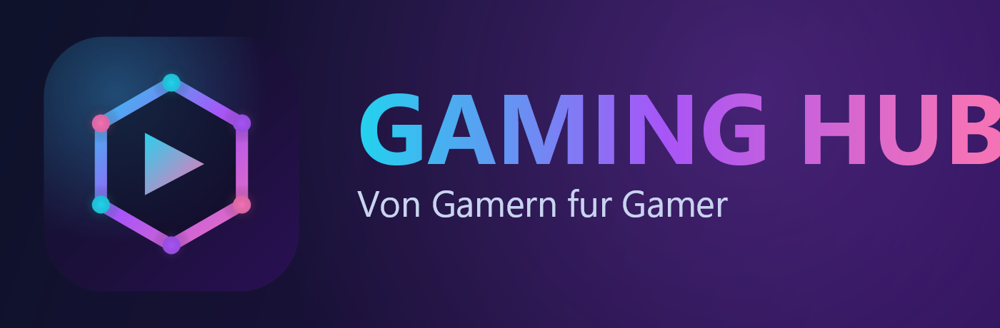

# Gaming Hub

**Gaming Hub – von Gamern für Gamer.** Eine Desktop-App für Windows, die deine Spiele
verwaltet, den Speicher aufräumt, deine System-Ressourcen überwacht und dir sagt, ob
dein PC ein Spiel schafft.

> ⚠️ **Haftungsausschluss:** Gaming Hub wird „wie besehen“ (as-is) bereitgestellt.
> Die Nutzung erfolgt **auf eigene Gefahr**. Wir haften **nicht** für Schäden an Hard-
> oder Software, Datenverlust oder sonstige Schäden, die aus der Nutzung dieses
> Programms entstehen. Das Cleanup-Modul kann Dateien löschen – prüfe jede Auswahl
> sorgfältig und lege Backups an.

---

## Funktionen

### 🎮 Spiele
- Erkennt installierte Spiele von **Steam** (Library-Manifeste), **Epic Games** und aus der **Windows-Registry**
- **Starten / Stoppen / Neustarten** direkt aus der App
- Automatische **Spielzeit-Erfassung** pro Spiel
- **Speicherplatz** je Spiel und Übersicht **pro Laufwerk**

### 🧹 Disk Cleanup
- Findet **doppelte Dateien** zuverlässig (Größen-Vorfilter → Teil-Hash → voller SHA-256-Abgleich)
- Listet alle Duplikat-Gruppen auf, Original wird markiert
- **Full Auto Clean** (behält je Gruppe eine Datei) oder **manuelles Löschen**
- Optional sicher über den **Papierkorb**

### 📊 System-Ressourcen
- Live-Anzeige von **CPU, RAM und GPU** (Name, VRAM)
- **Kompatibilitäts-Check**: schätzt ein, ob dein PC ein Spiel schafft und empfiehlt
  eine Einstellung (**Niedrig / Mittel / Hoch / Ultra**)

### 🐞 Bugreport
- Bug melden mit **Kategorie**, **Reproduktions-Schritten** und **App-Version**
- Die Version ist in der gesamten App immer sichtbar

### 🔄 Updates & Extras
- **Auto-Update** über GitHub-Releases (Velopack) – prüft beim Start, installiert und startet neu
- Manuelle Update-Prüfung in den **Einstellungen**
- **Start-Animation** mit dezentem Sound
- **Haftungsausschluss** beim ersten Start
- Selbst generiertes **Logo** (App, Fenster, Installer)

---

## Roadmap

| Phase | Inhalt | Status |
|------:|--------|:------:|
| 1 | Fundament, Logo, Disclaimer, Splash, Updater | ✅ |
| 2 | Spiele (Erkennung, Steuerung, Spielzeit, Speicher) | ✅ |
| 3 | Disk Cleanup (Duplikate, Auto-/Manuell-Löschen) | ✅ |
| 4 | System-Ressourcen & Kompatibilitäts-Check | ✅ |
| 5 | Login (E-Mail/Google/Discord), Profile, Badges/Achievements | 🗓️ geplant |
| 6 | Chat, Sprach- & Videochat (WebRTC + Supabase) | 🗓️ geplant |
| 7 | Website mit Download & Bugtracker (Admin-Moderation) | 🗓️ geplant |

---

## Technik

- **.NET 10** + **Avalonia UI** (12)
- **CommunityToolkit.Mvvm**
- **Velopack** (Auto-Update über GitHub Releases)
- **SkiaSharp** (Logo-Generator unter `tools/`)
- Geplant: **Supabase** (Auth, Realtime, Datenbank)

## Projektstruktur

```
src/GamingHub.App     Avalonia-Oberfläche
src/GamingHub.Core    Fachlogik & Windows-Integration (Scanner, Cleanup, Monitoring)
tools/GamingHub.LogoGen  Erzeugt Logo (PNG/ICO) und Intro-Sound
assets/               Generierte Assets (Logo, Banner, Sound)
```

## Selbst bauen

```powershell
# Voraussetzungen: .NET 10 SDK
dotnet build GamingHub.slnx

# App starten
dotnet run --project src/GamingHub.App

# Logo & Sound neu erzeugen
dotnet run --project tools/GamingHub.LogoGen -c Release
```

## Release / Update-Mechanik

Releases werden über **Velopack** paketiert und als GitHub-Release veröffentlicht
(siehe `.github/workflows/release.yml`). Die App zieht Updates automatisch aus
diesem Repository.

---

## Lizenz

MIT – siehe [LICENSE](LICENSE).
